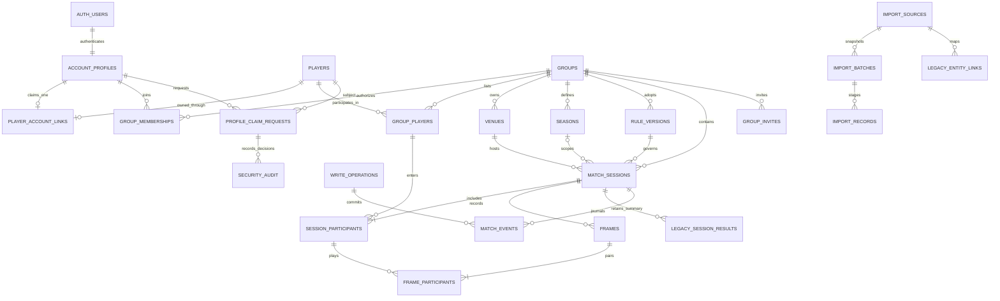
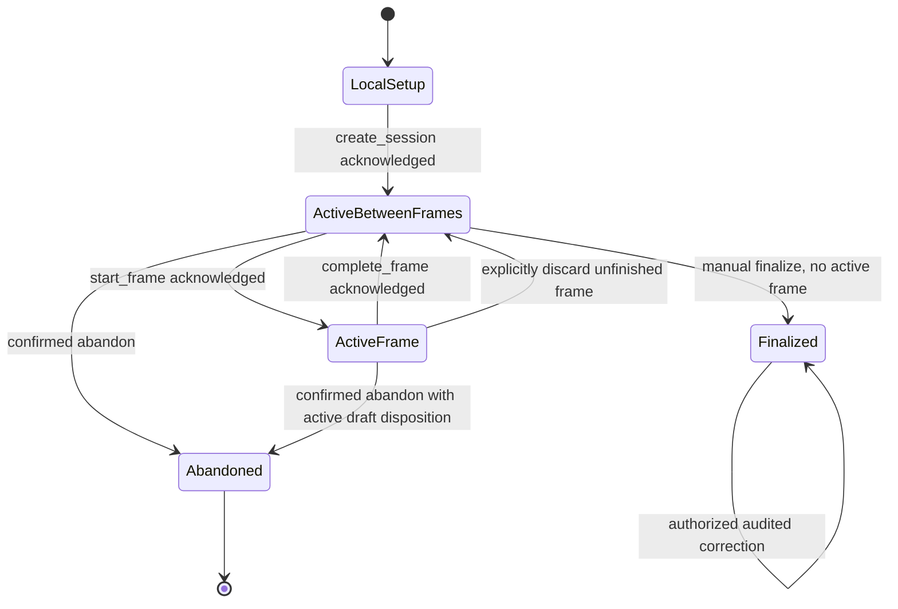

# Pule 2.0 — Database Architecture and Historical Migration Plan

**Implemented owner-approved multiplayer extension (3 November 2026):** sessions now support 2+ registered roster participants and each frame explicitly selects exactly two distinct session participants. Session `side` is positive roster order; frame `side` remains 1/2. Native standings count actual completed-frame wins/losses/appearances, with shared win-count ranks and no sitting-out losses. Group night W/L/D remains an exact-two-player measure; multiplayer nights are reported separately. Historical reported-result authority is unchanged. These requirements supersede the two-player-only MVP and future-rotation language below. Additive migrations `003` and `004`, onboarding services, actual test results and hosted gates are documented in [MULTIPLAYER_READINESS_REPORT.md](MULTIPLAYER_READINESS_REPORT.md).

Prepared 3 November 2026. **Design reference; database foundation implemented under the subsequent explicit owner request. See DATABASE_FOUNDATION_REPORT.md for implemented scope, tests and remaining gaps.**

## 1. Executive summary and architectural decisions

Build a group-isolated Supabase PostgreSQL application around **open-ended match nights and individually started frames**. Permanent player identities, authenticated accounts, group membership and recorded participation are separate concepts. A guest can be recorded without having an account; claiming later changes ownership links, never historical player IDs.

This design uses [LEGACY_FEATURE_AUDIT.md](LEGACY_FEATURE_AUDIT.md) as the authoritative description of recovered client functionality. Its H citations refer to the original `pule_app/index.html` locations. [PRODUCT_PLAN.md](PRODUCT_PLAN.md) supplies reliability and maintainability goals; its earlier scoring hypotheses are superseded here by the audit and the current requirements. [PROTOTYPE_NOTES.md](PROTOTYPE_NOTES.md), `src/features/scoring/useDemoMatch.ts` (`DemoMatch`, `demoReducer`), and `src/data/fixtures.ts` (`Match`, `PlayerId`) describe a fictional presentation prototype, not a production domain contract.

| Decision | Why / trade-off |
| --- | --- |
| PostgreSQL with group-scoped relational facts | Foreign keys, transactional commands and RLS enforce invariants across independent groups. More explicit tables and tests than a single JSON score sheet. |
| Private permanent `players`; separate account links and group-visible player records | Donal, Sean and Alan can begin as unclaimed UUID identities. One identity can appear in several groups without exposing other groups or account information. Requires an intentional, verified cross-group linking process. |
| No mandatory target score | Preserves manually finalized match nights; `target` from the React prototype is not a required database field. Future formats need explicit rule versions. |
| Two session participants, same pair every frame in MVP | A clear supported scope, while participant junctions allow future rotating pairs. Higher-cardinality legacy data is preserved separately pending verified interpretation. |
| Completed frames determine native scores | Client counters are projections, not authoritative writes. All approved historical imports use their reported result as result-level authority, independently of sequence quality. A per-session authority selector prevents double counting. |
| Typed current tables plus append-only domain journal | Queries use relational projections; accepted commands, completed snapshots and corrections are journaled transactionally for audit/replay. More storage and replay-version discipline; no need for a separate event-stream service. |
| Narrow transactional RPCs for writes; RLS-protected reads | Whole frames, claims, membership changes and corrections commit atomically. Browser cannot update protected ownership/counters through generic CRUD. More server-side contracts to maintain. |
| Private groups by default, even for a publicly available app | Anyone may eventually register; registration does not expose other groups' history. Public leaderboards/sharing are future explicit permissions, not a side effect of launch. |
| Versioned statistics from eligible evidence | Retains original analytical capabilities while correcting known inconsistencies. Some historical totals may differ from legacy displays; reconciliation must explain each difference. |
| Copied-export, staged and idempotent migration | Keeps production untouched and provides source-to-destination traceability. Workbook mapping is now recovered; missing Apps Script semantics still prevent a full rule-parity claim. |

The private workbook `data/legacy/historical-scores.xlsx` has now been inspected read-only; [HISTORICAL_DATA_AUDIT.md](HISTORICAL_DATA_AUDIT.md) documents actual columns and source figures. [MIGRATION_VALIDATION_REPORT.md](MIGRATION_VALIDATION_REPORT.md) documents the executable dry run and owner-approved exceptions. Apps Script source remains unavailable: automatic breaker policy, upstream aggregate formulas and season rules are not verified. Workbook evidence supersedes earlier hypothetical mapping assumptions. No production access is needed.

## 2. Confirmed requirements and explicit assumptions

**Owner scope decision:** Total Bill and all billing/financial functionality are excluded from the product, schema, normalized import evidence, migration payloads and statistics. Ignore numeric values from the historical field. A completion-status token found in that column because of legacy layout drift may be extracted solely as status evidence with its source locator; the source workbook itself remains untouched.

Use the following labels throughout: **L** confirmed legacy client behavior; **M** confirmed current MVP requirement; **P** proposed new implementation policy awaiting approval; **U** unverified backend/workbook behavior; **F** future extension.

| Classification | Requirement / evidence |
| --- | --- |
| L + M | Venue and players, initial breaker, start session, gate, explicit frame start/timer, winner and metadata confirmation, repeat frames, manual finalization. Audit §§3–5; H:1672–1705,1088–1108,1844–1965. |
| L + M | Winner, breaker, scratch counts, break-pot Boolean, pocket, event, offender and duration must be preserved. Audit §6.2; H:1879–1892. |
| L + M | Correct previously logged winner/foul counts reliably; preserve frame history and result-only records. Audit §§5–6.4; H:796–875,1599–1639. |
| M | Public registration eventually, independent groups, any two group-available existing players can play, database-loaded player/venue lists, persistent setup-created guests and venues. No hard-coded preferred pair. |
| M | Two session participants and the same two active players for every frame in MVP. This resolves the legacy client's inconsistent >2 selection for new sessions; it does not explain historical multi-player records. |
| M | Permanent player UUID survives account registration/claim; claiming is verified, atomic, unique and auditable. Membership and claiming are independent. |
| P | Cloud writes require an authenticated group member with scoring permission. **The guest player need not register**; the person recording/creating them does. No anonymous database write access. Confirm this actor/player distinction before implementation. |
| P | Private membership-based reads; viewers, scorers, admins and one owner per group. One designated active scorer per session, explicit handover. Multiple sessions per group are allowed; do not recreate a single global active-session variable. |
| P | Abandonment is an auditable excluded state, not immediate irreversible deletion. Native finalization requires at least one completed frame and no unfinished frame; approved imported score-only completion uses source status evidence. Tied finalized scores are valid draws. |
| P | One active account link per player and at most one claimed player identity per account for MVP. Multiple-group participation is many-to-many and does not require multiple identities. Duplicate identity resolution is a separate reviewed process. |
| U | Apps Script next-breaker rule; construction of winners, seasons, tracked breaks, receiving aggregates, pace categories, date/time zones and active-session ownership. Audit §§6.4,7.5–7.10,9,14. |
| F | Rotating session participants, public opt-in publishing, inter-group competition, anonymous practice drafts and account-global personal analytics with separate consent. Not MVP scoring rules. |

New safeguards must not silently relabel old evidence as valid. In particular, legacy pause-duration defects and contradictory special events are preserved as source facts with quality flags, not silently “fixed” by invented values. Prototype `seconds`, frame-winner side arrays and fictional match scores will never be imported.

## 3. Proposed entity relationship model



Diagram omits repeated `group_id` composite-key relationships and platform authorization tables for readability; section 4 specifies them. Optional season cardinality means a session can be unassigned, not that All-Time is a season row. Frame winner, breaker and offender all reference **that frame's** participant pair.

Group history owns the evidence; claiming a player never transfers, merges or publishes the evidence across groups. A session has exactly one owning group. Future inter-group matches need an explicit sharing model, not duplicate canonical records.

## 4. Detailed table-by-table schema

This is a logical schema specification, **not executable DDL**. `uuid` identities are opaque, immutable and never based on names. Use random UUIDs for native entities and the documented deterministic source-key mapping for reviewed imports; unguessability is not authorization. `?` means nullable. IDs not marked `?` and required invariant fields are NOT NULL. Timestamps are `timestamptz` in UTC; calendar dates are `date`. Server timestamps/actors cannot be overwritten by ordinary callers.

### 4.1 Shared conventions and integrity boundaries

- `app` denotes an explicitly exposed application schema for narrowly granted RLS reads/RPCs; `private` is not exposed through the Data API. Enable RLS on application tables and sensitive private tables as defense in depth; database owners/migration roles still require operational controls.
- Group-owned records carry `group_id`. Parents expose `UNIQUE(group_id,id)`; children use composite FKs including `group_id`. Merely placing RLS on two unrelated UUID columns does not prevent cross-group relationships.
- Unless stated otherwise: UUID PK, `created_at` server default, `updated_at` server-managed on mutable projections, `revision bigint >= 1`. Identity/group/provenance columns are immutable through normal mutation interfaces. Soft archive referenced entities; hard-delete references normally RESTRICT.
- Account-private `account_profiles.user_id` references the documented `auth.users.id` primary key; Auth is not queried as a public player directory. This follows Supabase's supported reference boundary, while retention below deliberately differs from deleting gameplay records on account deletion. [Supabase user-data guidance](https://supabase.com/docs/guides/auth/managing-user-data).
- Use CHECKs for row-local domains/ranges, FKs/uniques for references and collision control, **deferred constraint triggers plus locked transactional functions** for participant counts, containment, session state and timer/event consistency. Cross-row conditions must not be disguised as CHECK expressions. [PostgreSQL constraint semantics](https://www.postgresql.org/docs/current/ddl-constraints.html).
- Text names: trimmed nonempty, bounded length (proposed 1–100 characters; venues 1–160). A normalized search key helps find duplicates, but names are **not globally unique**. No automatic merging or claiming from case-folded names. Render all names as text, not HTML.
- Historical nullable facts mean unknown, not zero. Validation relaxations are limited to a trusted import path with explicit `origin`, `coverage` and `quality`, never a browser-supplied `is_import` bypass.
- Imported application rows additionally carry `import_batch_id uuid?` and a source-record/link reference; native rows leave these null. Composite FKs bind batch/source to the same group. Ordinary RLS reads also require an accepted batch for imported rows. The private batch-check helper returns only eligibility for the current group/row, not batch contents.

### 4.2 Accounts and permanent identities

| Table | Columns and relationships | Constraints / indexes / deletion policy |
| --- | --- | --- |
| `app.account_profiles` | `user_id uuid PK → auth.users.id`, `actor_ref uuid UNIQUE` (server-created audit pseudonym), `display_name text`, timestamps, `status` active/disabled. No Auth email duplicated in group-readable records. | Self-readable only; permitted display-name edit only. Auth deletion can cascade account-only profile after controlled cleanup; audit pseudonym survives in journals without a usable login mapping. Actor references do not grant privileges. |
| `private.players` | `id`, `origin_group_id → app.groups`, `identity_revision bigint`, `status` active/retired, timestamps, created actor reference. Historical names are preserved in group/source records rather than a globally searchable name directory. | Origin immutable. No automatic player deletion when account/group membership is removed. No direct browser access. Origin-group FK RESTRICT; groups archive while player history exists. Index origin group. |
| `private.player_account_links` | `player_id PK → players`, `user_id UNIQUE → auth.users.id`, `claim_request_id UNIQUE → profile_claim_requests`, `linked_at`, verifying actor reference. | One current owner per player and one player per account. Approval transaction only. Auth deletion removes current ownership link through controlled unlink; does not delete player/history. Before removal, append security audit and close affected pending claims. A later account with same email has no inherited ownership. |

**Why group-local names:** group A must not learn that a shared player uses a different name, has an account, or belongs to group B. Normal group-facing reads use `group_players` labels. The private global identity enables verified linkage, not a public people-search service. Trade-off: joining a new group may need an invitation/link code or self-introduction rather than searching all users by name.

### 4.3 Tenants, rosters, venues, seasons and rules

| Table | Columns and relationships | Constraints / indexes |
| --- | --- | --- |
| `app.groups` | `id`, `name`, `status` active/archived, `timezone text` valid IANA zone, `membership_revision bigint`, timestamps. | Creation RPC atomically creates group and owner membership. Group timezone change requires reviewed date policy; it must not silently shift historical `occurred_on` or season membership. No public discovery/read by default. |
| `app.group_memberships` | Composite PK `(group_id,user_id)`; FKs groups/Auth, `role` viewer/scorer/admin/owner, `status` active/revoked, `joined_at`, `revoked_at?`, `revision`. | Index `(user_id,status,group_id)` for RLS; unique partial `(group_id)` where active owner gives at most one owner. Deferred trigger requires exactly one active owner for an active group; transfer locks group and updates both memberships atomically. Prevent self-promotion. Membership revocation/auth deletion cleanup cannot leave an ownerless active group. |
| `app.group_players` | PK `(group_id,player_id)`; players/groups FKs; group-local `display_name`, normalized search key, `status` active/archived, `joined_at`, `revision`. | Index `(group_id,status,normalized_name)`, reverse `(player_id,group_id)`. Names not unique; disambiguate in UI. Only trusted guest-create/verified-link commands can insert. Removing from active selection archives row without deleting past participant links. |
| `private.group_invites` | `id`, `group_id`, `token_hash UNIQUE`, `invited_role` (never owner), `expires_at`, `max_uses`, `uses`, `revoked_at?`, creating actor; optional verified recipient constraint. | CHECK positive uses limit and `0<=uses<=max_uses`. Redeem while locking invite/group, bind caller, check expiry/recipient. Store hash, never reusable plaintext token in logs; rate limit. Owner transfer is a separate command. Index group/expiry. |
| `app.venues` | `id`, `group_id`, `display_name`, search key, optional locality label, `status` active/archived, timestamps/revision. | Unique `(group_id,id)`, search index `(group_id,status,search_key)`. Creation from setup persists immediately with operation ID. Same names can describe different places; warn, do not collapse automatically. No cross-group FK to a private venue. |
| `app.seasons` | `id`, `group_id`, `name`, `starts_on?`, `ends_before?`, `assignment_mode` date_range/manual_legacy, `status`, revision. | Unique `(group_id,id)` and `(group_id,name)`; start<end when both present; date_range requires both dates. Creation/changes lock group and reject overlapping automatic ranges. Manual source seasons need no invented boundaries. All-Time means no season predicate, not a row. |
| `app.rule_versions` | `id`, `group_id`, `version_label`, `schema_version`, `rules_status` verified/legacy_unknown, `session_format` open_night/legacy_other, `breaker_policy_code?`, `breaker_policy_version?`, `validation_settings jsonb`, adoption actor/date. | Unique `(group_id,id)` and `(group_id,version_label)`. Immutable once referenced; JSON schema validation and strict allowed keys. New native sessions require approved settings, not legacy_unknown. No unverified alternation/winner-break rule in defaults. Public clients cannot insert arbitrary rules. |

Keep season assignment on each session, and record changes. Derive a new native session's occurrence date in its snapshotted group timezone when started; imports retain source date precision. Historical rule version `legacy_unknown` is honest evidence, not a claim that source records conform to a newly defined ruleset.

### 4.4 Match-night sessions and participants

| Table | Columns and relationships | Constraints / indexes |
| --- | --- | --- |
| `app.match_sessions` | `id`, `group_id`, `venue_id`, `season_id?`, `rule_version_id`; `status` active/finalized/abandoned; `record_kind` frame_log/result_only; `coverage` complete/partial/none; `origin` native/imported; `quality` accepted/limited/disputed; independent `result_authority` native_frames/approved_historical_reported, `result_quality` approved/disputed/unknown, `sequence_quality` reconciled/partial/disputed/not_recorded, versioned detail-eligibility policy; `occurred_on date?`, `occurred_at timestamptz?`, `date_precision` instant/date_only/unknown, `source_order_key?`, `timezone_snapshot`; `started_at?`, `finalized_at?`, `abandoned_at?`, `initial_breaker_id?`, `next_breaker_id?`; `scorer_user_id? → auth.users.id`, `scorer_generation bigint`, `revision`, provenance link, server timestamps. | Composite FKs for venue/season/rule to same group; breaker IDs reference session participants (deferred FKs for creation). Partial coverage allowed for imported evidence, not new completed native data. Result-only must be imported, finalized and have zero frame rows. Native lifecycle timestamps remain mandatory/coherent. Trusted imported completed records may have date-only occurrence plus completion-status evidence and null started/finalized timestamps; ingestion timestamps are separate, never historical completion times. Finalized/abandoned are mutually exclusive. Index `(group_id,status,updated_at)`, `(group_id,season_id,occurred_on,id)`, venue/date. No unique active session per group. |
| `app.session_participants` | PK `(session_id,player_id)` plus `group_id`, `slot smallint`, name snapshot, optional provenance. Composite FKs `(group_id,session_id)` to sessions and `(group_id,player_id)` to group_players. | Unique `(session_id,slot)`, slot>0. Deferred trigger/RPC: native MVP exactly two distinct players, fixed after start. Imported >2 records may be retained as limited legacy evidence, excluded from exact-pair metrics until interpreted. Index `(group_id,player_id,session_id)` for history/H2H. No mutable current total column. |
| `app.legacy_session_results` | PK `(session_id,player_id)`, `group_id`; FK same-group session participant; `reported_frames_won integer?`, `reported_outcome` win/loss/draw/unknown, `raw_winner_label?`, `result_quality` approved/disputed/unknown, provenance link. | CHECK score>=0 when known. Import-only current result projection backed by immutable source observations; authoritative for **every approved imported result**, including tracked sessions with disputed detail. Exactly one approved current result per session participant, with immutable source evidence and auditable revision selection. Never add to frame-derived totals. Native scores remain frame-derived; browsers cannot choose or change result authority. |

Session scores and running scores are derived: for native/full frame-log sessions count current nonvoid completed frame winners per session participant, including zero-score participants in the result. `runningScore` is a query over accepted frame sequence; never an independently writable string. Session participants remain after group-player archive or account unlink. `source_order_key` is nullable text containing only an evidenced chronological key, not import row order. `timezone_snapshot` may be null for imports whose source zone is unknown; a group display zone must not be misrepresented as recovered source time. Native sessions require a valid snapshot and known occurrence date.

For imported partial/disputed frame logs, retain reported results and canonical frame counts as separate facts. **Updated owner decision:** all 36 historical nights remain eligible for result-level calculations, including `m_1793225336292` (2026-10-28), Donal 12–5 Sean. Exclude the zero-second source observation at Frames row 420 from canonical/scored frames. Under the latest owner instruction, preserve its COMPLETE evidence privately as `excluded_noncanonical`, with no canonical ID or detail eligibility. Leave the source workbook unchanged; retain the exclusion ledger and full private source observation. Source row 419 remains frame 14, and frames 15 and 16 retain their numbers. The retained 16 frames total 11–5, which does not replace the approved reported 12–5. Conservatively exclude this night's detail from aggregates while this result/detail discrepancy remains. Current counts: 421 workbook frame rows, one excluded, 420 retained observations and canonical proposals, zero quarantined observations, 404 detail-eligible frames and 726 reported frame wins. No synthetic frame fills the difference.

Score-only imports have zero raw/canonical frames and remain first-class result history. Import exceptions use a trusted, versioned mapping path and field-quality flags; they do not weaken native completion checks, frame uniqueness, participant constraints, timing validation or event legality. Imported `rule_version_id` may reference an explicit non-playable `legacy_unknown` context, never an invented legacy rule. Missing breaker, break-pot, offender, timing anchors, timezone and season remain unknown.

### 4.5 Frames, frame participants and accepted journal

| Table | Columns and relationships | Constraints / indexes |
| --- | --- | --- |
| `app.frames` | `id`, `group_id`, `session_id`, `frame_number integer`; `status` running/paused/completed/discarded/voided; `breaker_id?`, `winner_id?`, `offender_id?`; `potted_on_break boolean?`; `black_pocket_code?` TL/TM/TR/BL/BM/BR; `pocket_state` recorded/not_recorded/not_applicable; `special_event?` regular/golden_break/break_and_run/dry_clearance/super_foul; `elapsed_ms bigint?`, `running_since timestamptz?`, `started_at?`, `completed_at?`; `duration_quality` server_measured/offline_reported/manual/imported_unverified/unknown; `origin`, field-quality flags, `revision`, timestamps/provenance. | Unique `(group_id,id)`, `(group_id,session_id,id)`, `(session_id,frame_number)` including voided numbers; number>0, elapsed>=0 if known. Unique partial session_id for status running/paused gives one active frame. FK same-group session. Winner/breaker/offender use `(group_id,frame_id,player_id)` FKs to that frame's participants, deferred where insertion order requires. Typed domains and status/clock consistency CHECKs; completion invariants via command + deferred trigger. Index `(group_id,session_id,frame_number)` and `(group_id,winner_id,completed_at)`. |
| `app.frame_participants` | PK `(frame_id,player_id)`, `group_id`, `session_id`, `side` 1/2, `foul_count integer?`, per-field source quality. Composite FKs to frame and session participant. | Unique `(frame_id,side)`; side 1 or 2, foul>=0 when known. Exactly two distinct participants per frame via deferred constraint trigger; new MVP frame pair must equal session pair. Native new frames initialize both counts to 0; imported blanks remain null. Index `(group_id,player_id,frame_id)`. |
| `app.match_events` | `id`, `group_id`, `session_id`, `sequence bigint`, `event_type`, `event_schema_version`, `operation_id → private.write_operations`; `frame_id?`, `entity_revision`, `actor_user_id?`, stable `actor_ref`, `committed_at` server time, optional `client_occurred_at`/device sequence; `payload jsonb`, correction `reason?`, prior-event reference where applicable. | Unique `(session_id,sequence)`; one event per accepted session command, sequence = resulting session revision. Append-only; browser cannot insert/update/delete. `(frame_id,entity_revision)` unique for frame mutations. Composite parent FKs prevent cross-group references. Index group/session/sequence and frame/revision. Payload is versioned, size-bounded and validated, not arbitrary client JSON. |

**Journal/projection contract:** each accepted creation/start/input-snapshot/pause/resume/complete/correct/discard/abandon/finalize command appends a domain event and updates typed current tables in the **same transaction**. Completion/correction events contain a full validated frame snapshot including participant UUIDs and foul counts, breaker, pot, pocket state/code, event, offender, elapsed duration/quality and sequence. Session events contain the necessary participant/rule/lifecycle snapshot. Imports produce explicit `imported_snapshot` events; never invented played-at timestamps or fake per-shot events.

The accepted journal plus immutable import provenance is the reconstructable history; tables are query projections. All frame mutation events include the resulting clock/status/revision state; completion and correction also include the full factual snapshot. Replaying events uses those accepted anchors and elapsed values, never the current clock. Session events retain any changed scorer generation, lifecycle or next-breaker suggestion needed to reconstruct state. Replay must reproduce frame facts and scores for each schema version. Replay does not invoke Auth or redo real-world claim verification. Audit history is not a second editable score source. JSON is confined to schema-versioned journal snapshots, rules and import evidence; frequently queried facts remain typed. This refines the product plan's event-journal principle without implementing an unnecessary generic event platform.

### 4.6 Commands, claims and security audit

| Table | Columns and relationships | Constraints / indexes / access |
| --- | --- | --- |
| `private.write_operations` | `operation_id uuid PK`, bound `actor_ref`, `actor_user_id?`, `group_id?`, command name, canonical `request_hash`, committed result references/revisions, `committed_at`. | One immutable receipt per successful command. Same actor/key + identical request yields same result; different payload or actor is rejected. No caller-chosen actor. Rolled-back writes leave no success receipt. Index actor/date and group/date. Receipts retained at least for supported retry lifetime; old operation IDs cannot be reused after pruning (retain tombstone). |
| `private.profile_claim_requests` | `id`, `player_id`, `requester_user_id?`, requester actor_ref, `sponsoring_group_id`, `status` pending/approved/rejected/withdrawn/expired/cancelled; `expected_identity_revision`; reference to restricted verification evidence, `expires_at`, decision actor/date/reason, timestamps. | One pending request per `(player_id,requester)` and at most one pending per requester under MVP one-player rule; **competing claimants may have separate pending requests**, not a first-request lockout. Approval uniqueness enforced by account-link keys. Sponsor must be a group where profile is listed; not authority to see other groups. Index player/status and requester/status. |
| `private.security_audit` | `id`, `group_id?`, `actor_user_id?`, `actor_ref`, action, subject IDs, request/operation ID, server timestamp, before/after references or bounded snapshots, reason, evidence reference. | Append-only restricted writer. Group admin sees sanitized group-security events, not global identity evidence or other groups. Platform reviewer access separately audited. FK-to-Auth deletion may SET NULL but keeps nonlogin audit reference under approved retention. Index group/time and claim/subject/time. Never store passwords, tokens or unnecessary identity documents here. |
| `private.platform_permissions` | PK `(user_id,capability)`; capability identity_reviewer/import_operator; status, grantor, expiry and audit linkage. | Not group-admin controlled; provisioning through audited trusted operations only. Validate every privileged request from database state, not editable Auth metadata. Index active user/capability. Platform review/import access is least privilege, not a universal implicit application admin. |

### 4.7 Migration provenance and staging tables

| Table | Columns and relationships | Constraints / indexes |
| --- | --- | --- |
| `private.import_sources` | `id`, `group_id`, logical source namespace, source system label, source ownership record; no live endpoint or credentials. | Stable source identity persists across snapshot batches. Unique `(group_id,namespace)`. Prevent accidental reimport into a different group. |
| `private.import_batches` | `id`, `source_id`, `group_id`, exported file checksum, schema/mapping/importer versions, snapshot/export time and precision, approval references, `status` staged/validated/importing/reconciled/accepted/failed/rolled_back, report reference, timestamps. | Unique `(source_id,checksum,mapping_version,importer_version)` for exact reruns. Activation only after reconciliation sign-off; partial staging not visible to members. Concurrency limited to one active canonical import per source. |
| `private.import_records` | `id`, `batch_id`, `group_id`, logical record kind/key, sheet/row/field locator **as discovered**, raw-value/formula artifact reference, parsed normalized payload, row hash, validation status/errors, linked mapping ID?, disposition. | Unique `(batch_id,record_kind,record_key)`. Split one workbook row into several traceable logical facts where needed. Sensitive raw workbook retained outside public repository in access-controlled storage; DB stores minimal references/normalized evidence. Preserve rejected and superseded evidence; no direct browser access. |
| `private.legacy_frame_observations` | `id`, `import_record_id UNIQUE`, `source_id`, `batch_id`, `group_id`, parent legacy ID **text**, source frame number, sheet/row locator, sanitized extracted facts/hash, field-quality flags; optional current canonical-frame link and disposition projection. | Immutable source facts, one observation per snapshot/sheet/row; repeated frame numbers are permitted here only. The excluded row 420 is preserved here privately with full evidence, disposition excluded_noncanonical, null canonical link and false detail eligibility. Future unresolved sources may use pending review independently. Numeric financial values are excluded from normalized evidence. No member/browser access. |
| `private.frame_observation_resolutions` | `id`, observation FK, previous/new disposition, optional canonical-frame target, mapping/review version, decision actor, reason, decision/commit time, expected revision, operation ID. | Append-only review history. Trusted transaction checks same-source/group links and uniqueness, appends decision, updates disposition projection, reconciles affected detail metrics. Never mutates source facts or changes approved reported result implicitly. |
| `private.legacy_entity_links` | `id`, `source_id`, `group_id`, `entity_kind`, `legacy_key text`, exactly one typed target: `player_id?`, `venue_id?`, `session_id?`, `frame_id?`; original name/ID reference, approved mapping version. | Unique `(source_id,entity_kind,legacy_key)`; CHECK exactly one appropriate target is nonnull. Typed FKs to players through group_players or same-group venue/session/frame. Several approved aliases may map to one player; distinct players may share a display name. Frame source keys include legacy parent identity. Reverse indexes each target. |

Canonical `app.frames` retains strict unique `(session_id,frame_number)`; do not weaken it to accommodate source collisions. Observation UUIDs are snapshot-sensitive; canonical session/player/frame IDs use stable reviewed source keys. The owner-excluded row receives a private observation identity and complete source evidence, but no canonical frame identity; its exclusion decision remains in the import report. Other future quarantined observations receive no guessed canonical identity. Later owner-reviewed resolution may link/reject it or create an explicitly reviewed frame identity with audit, never silently renumber source evidence. A reported-result amendment is a separate authorized operation with before/after evidence, reason and metric revision.

`legacy_match_id` is preserved losslessly as text via the session's source link (never cast away leading zeros or replace with UUID). New UUID targets persist across reruns through these mappings. An exact source ID collision with conflicting content is an exception, not an ON CONFLICT overwrite. Immutable batch records retain every imported version; trusted repair of mappings requires an audit decision.

### 4.8 Additional enforcement and indexing notes

No browser role may hard-delete a scored frame/session or change group/participant identity through an UPDATE. Referential history uses RESTRICT and archival. Account removal explicitly handles current links, memberships and scorer assignment without cascading into `players`, sessions, frames or events. Truly exceptional erasure/pseudonymization needs a reviewed retention procedure and must not be confused with gameplay abandonment.

Index composite FK lookup columns and RLS membership predicates. Start with the listed indexes, measure real query plans before adding large aggregate indexes. Session UUID pair filters use participant rows/joins, not parsing a display string like `Donal & Sean`. A deterministic UUID orientation gives stable H2H chart axes; display order is independent. No global uniqueness on names, venues or raw legacy match IDs across independent import sources.

## 5. Authentication and guest-player identity lifecycle

### 5.1 Four independent operations

| Operation | Result | Explicitly does not do |
| --- | --- | --- |
| Create guest player | Authenticated authorized scorer/admin invokes guest-create; creates permanent private player + group_players entry + operation receipt atomically. Imported Donal/Sean/Alan use the same unclaimed identity concept. | Does not create an Auth account, send credentials or grant membership. |
| Register user | Supabase Auth creates user; minimal account profile initialized safely. Verified login required before sensitive requests. | Does not auto-match names, claim a guest or join private groups. |
| Claim existing identity | Verified approval creates current player-account link, preserving player UUID and all references. | Does not rewrite history or grant access to all groups in which the player appears. |
| Join group | Redeemed invitation/admin approval creates active user membership/role; existing owned player may separately be linked into that group's roster with consent. | Does not claim another profile or give write permission just because a user appears as a participant. |

Guest creation from setup persists independently of whether a match is started. Idempotency prevents double-click duplicates; normalized-name suggestions help humans avoid duplicates but never decide identity. A cancelled setup can leave a valid selectable guest/venue. Correcting duplicates is a separate verified identity-resolution operation, deferred from automatic MVP behavior.

### 5.2 Secure claiming procedure

Proposed verification authority: **dedicated platform identity reviewer**. Group owners/admins may attest evidence for a group-origin guest; they cannot unilaterally seize a global identity that also participates elsewhere. This is safer than granting every group administrator global identity authority, but introduces manual review/support workload. Approve an operational reviewer process before public launch.

1. Caller signs in with verified account and recent reauthentication for claim/ownership changes. Show only permitted group-local guest candidates; no global search by name or email.
2. `request_profile_claim` binds requester from Auth, verifies sponsor-group visibility, creates pending request with identity revision. Name similarity alone is not evidence. Return generic unavailable messages to avoid revealing current owners.
3. Collect verification outside public group history, e.g. original group's accountable organizer attestation plus claimant verification through an independent trusted process. Exact acceptable evidence, dispute process and expiration require owner approval. Do not accept a submitted client `verified=true` or a guessable claim code as proof.
4. A trusted reviewer authorizes a particular request and evidence decision. Reviewers cannot approve their own claim; a second reviewer handles conflicts. Approval service validates reviewer capability from `platform_permissions`, not group role or a JWT user-supplied attribute.
5. One transaction locks relevant identity and account-profile rows in a consistent order, then request. Recheck pending/unexpired status, active authenticated parties, expected identity revision, evidence authorization, no existing player owner and no other player owned by requester. Insert link with unique player/user constraints, increment identity revision, decide request, append security audit and operation receipt. Conflicting approvals serialize; one succeeds, the other returns conflict without reassignment.
6. Close/cancel competing pending requests without exposing claimant evidence. Retrying the same approved operation returns receipt after current authorization checks. No table is ever “claimed” by setting an owner field from the browser.
7. History still references the same UUID: `legacy_entity_links → player P → session/frame participants`. Only `player_account_links(P,user U)` is new. A before/after reconciliation should prove identical participant IDs, scores and counts.

**Cross-group participation:** a verified owner can accept a roster invitation or provide a one-use, group-bound linking authorization. Trusted linking checks the same underlying identity and creates a new group_players row with that group's display label. Another group cannot link arbitrary known UUIDs without that authorization or reviewed legacy evidence. Claimant still needs ordinary membership to view group history. Future account-level “my results across groups” must union only currently authorized group scopes, not bypass membership through ownership.

Account takeover, relinquishment, unlinking and duplicate-player merges need an explicit dispute/recovery process. Do not silently free an identity to a new account on email reuse. Keep claim decisions auditable and sensitive evidence restricted; linkage does not prove every historical name occurrence was mapped correctly.

## 6. Group membership, roles and authorization

Proposed rights matrix; all assume active group and active membership except explicit onboarding/claim endpoints.

| Operation | Viewer | Scorer | Admin | Owner | Platform reviewer/import operator |
| --- | --- | --- | --- | --- | --- |
| View own group's roster, venues, finalized history and scoped statistics | Yes | Yes | Yes | Yes | No implicit membership access; purpose-limited privileged workflow only |
| View active session scoreboard | Yes | Yes | Yes | Yes | No implicit access |
| Create guest player / venue from setup | No | Yes | Yes | Yes | Import operator only for approved source/group |
| Start session / take assigned scoring role | No | Yes | Yes | Yes | No general scoring authority |
| Change active-frame inputs, start/pause/resume/complete | No | Assigned scorer only | Assigned scorer or explicit audited takeover | Same | No |
| Correct earlier frame in active night / finalize / abandon | No | Assigned scorer, expected revision and reason where applicable | Yes, explicit takeover/reason for conflict | Yes | No |
| Amend finalized history | No | No by default | Authorized correction with reason, revision and audit | Same | Approved import repair only |
| Invite/manage viewer/scorer membership | No | No | Yes, cannot grant admin/owner | Yes | No |
| Grant/revoke admin; transfer ownership | No | No | No | Yes, reauthenticated, atomic last-owner protection | Reviewed recovery process only |
| Rename/archive group-local player/venue | No | Create only; later edits by admin | Yes | Yes | Import mapping scope only |
| Request a claim for self | Permitted candidate + verified account | Same | Same | Same | Reviewer cannot self-approve |
| Approve global identity claim | No | No | Attest only | Attest only | Identity reviewer with verified evidence |

Participant identity does not imply login or permission. Claimed player ownership allows requests and own identity controls; it does not authorize edits to other players' matches or access to every private group. Membership roles are database state checked per command; account email/provider details are not group-readable.

For immediate write revocation, score commands hold compatible membership/group authorization locks; membership changes use conflicting locks and bump membership revision. Whichever commits first defines the authorization order. Reads take current database membership at statement time; an already returned page or exported data cannot be recalled. Realtime and client caches are never authoritative revocation mechanisms.

## 7. Row Level Security policy design

This is a policy specification, not migrations. Supabase RLS evaluates authenticated user identity and supports row predicates; view execution mode and function execution grants need separate care. [Official RLS guidance](https://supabase.com/docs/guides/database/postgres/row-level-security).

### 7.1 Read and write policy families

| Data family | SELECT / visibility | INSERT / UPDATE / DELETE |
| --- | --- | --- |
| `groups` | Caller has active membership; no anonymous list. Newly created group's owner sees it through creation result. | No general writes; create/rename/archive/transfer RPCs. |
| `group_memberships` | Caller reads own membership; admin/owner gets minimal member-management projection, not Auth emails. No ordinary viewer directory of account IDs. | No direct role/status writes; invitation and management functions only. |
| `group_players`, `venues`, `seasons`, `rule_versions` | Active member of that row's group. Group roster exposes local identity labels, not private owner/account links. | No direct writes; scoped validated functions prevent group reassignment and identity escalation. |
| `match_sessions`, `session_participants`, `frames`, `frame_participants`, eligible `legacy_session_results` | Active member of row's group for approved results. Sequence dispute alone must not hide an approved historical result. Unapproved result disputes and abandoned records are restricted to admins/recovery actors. Quarantined raw evidence remains private; sanitized frame detail discloses quality and eligibility. Parent/child group predicates agree. | No direct browser DML, including changing metadata, status, identity, source flags or counters. RPCs only. |
| `match_events` | Only a **sanitized group-scoped event view/RPC**, excluding device IDs, account IDs, private evidence and sensitive before-images. Ordinary client has no raw journal grant. | Append through trusted command function only; no browser edit/delete. |
| `account_profiles` | Self only; no group-based automatic full profile exposure. | Self update limited safe display-name columns under USING + WITH CHECK. Server actor/status fields not writable. No browser deletion. |
| Private identity/claims/audit tables | No table grants. Self-claim status and safe admin attestations via narrow RPCs. Global ownership/group participation never listed to arbitrary users. | Trusted verified operations only. |
| Private receipts/import tables | No table grants. Operation status RPC checks caller, group membership and receipt binding; import reports to approved operator/owner only. | Trusted command/import transactions only. |

Every relevant relationship is checked **both** by same-group FK containment and by authorization. A valid frame UUID belonging to another group must fail before any observable mutation or detailed response. A global player UUID is never sufficient to fetch or link a group roster entry.

### 7.2 Helper and privilege design

- Membership helpers take a row's group ID and internally derive current user using `auth.uid()`; unauthenticated/null user returns false. Query live memberships, not stale custom role claims. Index `(group_id,user_id)` and reverse lookup. Do not use user-editable metadata for privileges.
- Avoid recursive membership policies: a small private helper can read membership with a narrowly privileged definer role. It returns only a Boolean/capability for the **current caller**, never accepts arbitrary user IDs from browser. Do not expose internal helper schemas via the Data API.
- Direct writes are revoked even if table SELECT is granted. Intended simple account display edits use explicit column grants and separate USING/WITH CHECK self policy. RLS alone is not column authorization.
- Default RPCs use invoker rights where sufficient. Narrow definer functions are needed where callers lack base DML; explicitly authorize actor/group/action and all referenced entities. Fixed empty search path, fully qualified relations, no dynamic SQL/privilege escalation; least-privileged function owner. Revoke default function execution and grant only intended API signatures. [Supabase function security guidance](https://supabase.com/docs/guides/database/functions).
- Use `security_invoker` views where underlying RLS applies. Raw private-journal projections instead use a tightly scoped sanitizing read function, not a definer view with accidental broad access. Cache/materialized tables are private unless their own group scoping is proven. [View isolation guidance](https://supabase.com/docs/guides/database/postgres/row-level-security#views).
- Group filters supplied by the browser constrain presentation; they never replace membership predicates inside RPCs/queries. Totals, COUNTs, joins, exports and diagnostic errors must obey the same boundary. Claim/receipt lookup errors should not reveal foreign row existence.

### 7.3 Direct reads versus trusted operations

Direct RLS-protected reads: group-scoped player/venue choices, approved rule/season definitions, session lists/details and safe current frame facts. Self-profile display edits can use limited RLS UPDATE. All meaningful gameplay and identity/membership mutations use transactions in section 9.

Trusted server/Edge logic: invitation delivery if later authorized, claim evidence review, account recovery/deletion, import orchestration and rate limiting. Verify request JWT and required capabilities server-side; use caller JWT where possible. A service-role/secret key is never included in Vite variables, browser code or user-visible logs. A privileged key can bypass RLS, so the import/review service must still bind every operation to its approved group/subject. Keep privileged clients separate from request-user clients.

**Required denial tests:** two disjoint groups, a user in both, a claimed player appearing in both, an unclaimed guest, revoked member, expired token, unrelated valid UUID, guessed claim/receipt IDs, forbidden FK links, unsafe view/function grants and admin self-promotion. Include SELECT/COUNT/nested joins and RPCs; no UI-only permission tests are sufficient.

## 8. Match-night and frame lifecycle

### 8.1 Session lifecycle



`ActiveBetweenFrames` and `ActiveFrame` are derived substates of `match_sessions.status=active`, not independently mutable duplicated status columns. A local pending finalization is **not** a server-finalized session. Result-only historical imports enter as finalized source observations after validation, without creating frame/timer transitions.

1. Setup loads group players/venues, allows persisted guest/venue creation, selects any distinct active pair and initial breaker from that pair.
2. `create_session` stores immutable initial participants, rules, venue/date context and scorer assignment. Return gate score 0–0 and proposed next frame number.
3. `start_frame` creates the two frame-participant rows and running timer snapshot atomically. Timer starts on explicit frame start, not when setup screen opens.
4. Record foul counts and metadata in active draft. Server-acknowledged draft snapshots do not contribute to the score. Pause/resume changes that frame's timer only.
5. Select winner and explicitly confirm. `complete_frame` validates all fields, freezes measured duration and appends completion snapshot. Return new derived scoreboard and gate in the same response; no second analytics fetch is required to declare the save successful.
6. Repeat indefinitely. There is no race-to-score termination. Manually finalize only with no active frame and at least one completed, nonvoid frame (proposed empty-night policy).
7. Finalized native outcome derives from frame wins: higher total wins; equal totals draw. No person is arbitrarily selected as winner on a draw. Native MVP exactly two participants makes this unambiguous. Retain unverified source outcomes for reconciliation; do not rewrite historical multi-player outcomes using this two-player definition.
8. Abandonment records reason/actor/time and stops any active timer; completed data remains available to authorized recovery/audit, excluded from ordinary leaderboards. This deliberately improves on the legacy destructive delete request; owner approval required for retention/deletion policy.

Frames: `running ↔ paused → completed`; an unfinished frame can be `discarded`; a completed frame can become `voided` only through an authorized compensating correction. Completed corrections otherwise keep the same UUID/number and increment revision. Do not reuse discarded/voided frame numbers; display gaps with explanations. This gives stable references for audits/imports. MVP exposes the existing winner/foul corrections first; broader discard/void/amend capabilities require agreed permissions.

A finalized session stays finalized when amended; its revision changes, derived results update and all affected records are recomputed. It is not silently reopened for ordinary scoring. Correction of a past frame must not overwrite or pause an unrelated currently running frame.

### 8.2 Correct timer handling and reloads

For a new online frame, use **persisted server transition timestamps**, not accumulated one-second interval ticks:

```text
start:  elapsed_ms=0; running_since=server_now; status=running
pause:  elapsed_ms += server_now-running_since; running_since=NULL; status=paused
resume: keep elapsed_ms; running_since=server_now; status=running
finish running: elapsed_ms += server_now-running_since; running_since=NULL
finish paused:  keep elapsed_ms unchanged; running_since=NULL
final duration seconds = floor(elapsed_ms / 1000), once at presentation/export
```

Each transition is transactional, revision-checked and idempotent. Pause/resume duplicates cannot add time twice. Use monotonic client time only to animate between server snapshots; server duration and the API receipt establish acknowledged timing. Transport latency introduces a small difference between tap time and server acceptance; expose pending state rather than forging precision.

Reload fetches status, elapsed_ms, running_since and server_now with current revision. If running, reconstruct display from persisted anchor; if paused, show accumulated duration only. Backgrounding does not implicitly pause. Time spent away continues if the frame was left running. Provide an explicit reviewed duration correction if a user forgot to pause; quality becomes manual and original transitions remain auditable. Changing a device clock must not rewrite acknowledged online duration.

An imported final duration may exist without any start/stop timestamp. Store the reported duration/quality, with no invented intervals. Legacy pause overcount cannot be corrected without evidence. Future disconnected transitions use locally persisted timestamp/monotonic segments and `offline_reported` quality, not unearned `server_measured`; section 13 defines replay/reconciliation boundaries.

### 8.3 Breaker handling without inventing the server rule

Store initial, actual per-frame and next proposed breaker separately. Actual breaker belongs to the active pair and can be manually corrected with a journal event before completion. After completion, a **verified immutable policy version** may derive next breaker. The legacy source only consumes the server answer (audit §4.4, H:1654,1925).

Until a copied Apps Script rule or explicit owner decision is available, mark automatic policy unresolved. Do not default to alternate/winner/loser breaks. For a limited earlier pilot, the owner may separately approve explicit manual breaker choice for every frame; that is a declared new policy, not claimed legacy parity. Corrections to older results must not silently rewrite actual later breakers; recompute only a future suggestion and flag inconsistencies for review.

## 9. Frame event validation and transactional operations

### 9.1 Validation contract

| Rule | Required database enforcement | Status / historical treatment |
| --- | --- | --- |
| Tenant and participant containment | Session, venue, rule, season, all frame participants and all subject references belong to one group; actual frame pair belongs to session. Enforce composite FKs and validation under lock. | P secure foundation; MVP same pair confirmed M. Imported multi-player remains flagged. |
| Lifecycle | Active member/assigned scorer, active session, one active frame; start only between frames; confirm only running/paused; finalize only without active frame. | P enforcement of L workflow. |
| Winner | Exactly one winner from frame pair for a completed new frame; no frame draw assumed. Score changes only after completion. | L winner input; M preserve; no target-cap check. Imported unknown winner is incomplete evidence and excluded from outcome-dependent metrics. |
| Fouls/scratches | Both participant counts integers >=0 for new frames; +/- updates cannot underflow; corrections explicit. No auto-loss at third foul. | L field and warning at >=2, no verified third-foul penalty (audit B22). Historical missing count remains null. Foul/scratch terminology still needs confirmation. |
| Breaker | One of frame pair, selected at start; actual final value required for new native frame. | L field; automatic policy U. Unknown imported breaker stays null, reducing break coverage. |
| Break-pot status | Explicit Boolean for new completed frame; null for unknown imported value. | L recording capability. Do not default old blanks to false. |
| Pocket | One known code with recorded state, or explicit not_recorded/not_applicable with null code. No arbitrary string. | L six codes and None accepted. Whether omission should block normal completion is owner decision; proposal preserves explicit unknown rather than forcing a guess. Pocket orientation stays as drawn until defined. |
| Regular/none | Canonical `regular` for an explicitly normal frame; null means unknown imported event. Preserve raw `None` source mapping in provenance. | P normalization of L UI values; actual workbook mapping U. |
| Super Foul | Require offender from pair and winner=other participant; offender must be null for other events. Select offender may prefill opponent winner, but transaction checks relationship. | P correction of clear L “Offender Loses” UI intent; exact legal foul definition requires owner. Do not automatically add an ordinary scratch. Contradictory historical rows are flagged, not rewritten. |
| Golden Break / Break & Run | Proposed new validation: winner=breaker and potted_on_break=true, conditional on owner-confirmed meaning. No guessed pocket or automatic foul reset. | L event choice forces pot true but no enforcement; combination rule P, must be confirmed before enabling. Imported contradictions survive as limited/flagged evidence. |
| Dry Clearance | Preserve explicit selected event. Do not automatically infer receiver winner, pot false or zero fouls without approved rules. | L event label, semantic rules U. |
| Duration | Nonnegative elapsed, coherent clock state; completed clock frozen; quality required. No arbitrary maximum frames/time or speed-disqualification threshold invented. | P timing fix; historical defects remain flagged. Plausibility flags do not automatically delete outliers. |
| Correction | Same player/frame IDs, expected revisions, allowed fields, actor and nonempty reason; append full old/new evidence via event rather than overwrite journal. | M reliable correction; extra finalized-history permissions P. |

These checks live in schema constraints and transactional server functions. React mirrors them for usability but cannot bypass them. An import-only validation path stores imperfect source evidence without allowing ordinary callers to downgrade rules or origin flags.

### 9.2 Common transactional write algorithm

Every command carries `operation_id`, target IDs, expected session/frame revisions as applicable, payload schema version, and bounded typed values. Server derives actor and timestamps.

1. Authenticate; validate payload shape/size and current scope permissions. Bind authenticated account to stable actor_ref. Lock group authorization state/membership in a consistent order; do not authorize on names or client roles.
2. Acquire the operation receipt slot using its unique UUID. A concurrent identical request waits on uniqueness then returns the committed receipt; an identical key with a different normalized request hash/actor fails. Recheck current permissions before returning old receipts so revoked users cannot retrieve private historical responses.
3. Lock session row, then frame, in fixed order. Identity commands instead lock identity/account/request as specified in §5. Revision preconditions are checked **after** receipt replay detection, otherwise a successful retry would incorrectly fail against its own newer revision.
4. Check expected revisions, scorer generation and all referenced rows/states. A new operation with stale revision returns a conflict and current permitted revision; no silent rebase.
5. Apply typed projection changes, append immutable domain/security event, increment revisions, derive relevant score/timer/result and create receipt atomically. Roll back everything on failure. Never increment client/server score independently and then hope a refresh reconciles it.
6. Return operation ID, accepted event sequence, session/frame revisions and authoritative snapshot/score. Async analytics are not prerequisites for acknowledging committed gameplay.

Row locks serialize competing changes to a session; unique constraints provide independent duplicate protection. PostgreSQL documents the blocking semantics of `FOR UPDATE`; explicit locking still needs a consistent order and bounded retry for deadlock/serialization errors. [PostgreSQL locking reference](https://www.postgresql.org/docs/current/explicit-locking.html). Do not hold database transactions while awaiting human approval or an external network service.

Group authorization changes use the same lock ordering as score writes: group authorization row → membership(s) in stable ID order → operation receipt → session → frame. Ordinary score commands take compatible share locks on authorization rows; role/revocation/owner changes take conflicting update locks. Different sessions can still be scored concurrently. Reads need no scorer lock. For high-volume future groups, change this scheme only after measuring contention; the simple MVP choice trades some administrative write concurrency for clear revocation semantics.

### 9.3 Operation catalog

| Operation | Transaction contents / invariants |
| --- | --- |
| `create_guest_player`, `create_venue` | Check group capability; insert permanent ID/local roster or venue; audit + receipt. Duplicate operation returns existing entity. Similar name is a warning, not identity proof. |
| `create_group`, `redeem_group_invite`, `change_membership`, `transfer_group_owner` | Membership state, scope, last-owner invariant, token limits and security audit all atomic. Invite redemption works through a special authorization path before membership exists. |
| `create_session` | Verify active same-group pair/venue/rules/season; insert session+two participants, initial breaker/scorer; creation event and zero derived score. |
| `start_frame` | Allocate next stable sequence number under session lock (never `max+1` outside lock); insert frame+pair, zero foul draft, actual breaker and clock start; start event+receipt. Stable client-proposed frame UUID may be accepted for retry/offline continuity only after validation. |
| `update_frame_draft` | Validate full draft metadata/count snapshot against expected revisions and allowed fields. Preserve running clock fields; never accept client status or score. Debounced/coalesced UI updates must preserve local journal and latest unacknowledged input. |
| `pause_frame`, `resume_frame` | Compute/persist elapsed and anchor exactly once, append event, acknowledge clock state. |
| `complete_frame` | Validate pair/winner/metadata/clock; save final fields and both participants' counts; freeze elapsed; append complete snapshot; derive score and next-breaker policy output; return gate. No partially logged winner or orphan participant row. |
| `correct_logged_frame` | In active session, assigned scorer or authorized takeover corrects at least winner/fouls; finalized night requires admin. Lock containing session and targeted frame; append reasoned old/new snapshot, update projection/revisions, recompute result/running-score queries. Do not reset current other frame's timer or draft. Broader metadata/timing edits require explicit approved command schema. |
| `discard_unfinished_frame`, `void_logged_frame` | Explicit audited reason, state transition, no silent row deletion; exclude appropriate row from result. Proposed safety workflows, not mandatory recreation of nonexistent legacy frame-delete UI. |
| `finalize_session`, `abandon_session` | Check lifecycle; derive final score/outcome, timestamp and event. Abandon terminates active frame with explicit disposition. Finalization does not use browser counters. |
| `handover_scorer` | Authorized actor, expected revision; bump scorer_generation and transfer assignment with audit. Old queued writes fail rather than overwrite. No automatic takeover from a stale lease alone. |
| Claim request/decision/link | Restricted procedures from §5; unique link constraints, verified reviewer, audit. Claim request does not reserve identity against other legitimate claimants indefinitely. |
| Import accept/repair/rollback | Approved batch/group, validation report and dry run required; reserved trusted path, never a public `skip_validation` argument. |

**Structural enforcement:** junction tables additionally expose `UNIQUE(group_id,session_id,player_id)` and `UNIQUE(group_id,frame_id,player_id)` for composite FKs. Deferred constraint triggers validate exact pair cardinality after a command has inserted all related rows. Import/native exceptions are selected by trusted origin, not controllable caller parameters. Initial creation event sequence is 1 and session revision is 1; later accepted commands increment both by one. Generic identity/group commands append security audit rather than a fictional match event.

## 10. Statistics and analytics architecture

### 10.1 Computation and scope

Use version-controlled SQL query functions/views over current accepted projections, with reusable eligibility CTEs and fixture tests. Browser formats results/charts, never assembles its own competing denominators. Journal replay and migration reconstruction must produce the same inputs. Do not store mutable career counters as primary facts.

Start with indexed live queries; materialize only measured expensive workloads. Any later cache keys include **group, season/date filters, participant pair, rule compatibility, evidence/metric version and source-data revision**; caches remain private and membership-checked. Corrections increment revision and invalidate/recompute affected nights, rivalry histories and records. API returns `as_of`, metric definition version, eligible numerator/denominator, coverage and source limitations. A stale analytics cache is labeled stale, never allowed to overwrite a saved score.

All-Time means all eligible history **within the specified group**, not all groups in the database. Season applies consistently to results, break, pace, records and charts. Unassigned/unknown season contributes to All-Time only if other metric inputs qualify. Date-only records retain their date; unknown dates do not get guessed months/seasons. Exact-pair H2H requires two matching session participants for night outcomes; future rotating-frame comparisons must use frame pairs with distinct definitions.

Define:

- **R-outcome:** nonabandoned finalized nights with approved result quality, exactly two participants and known consistent outcome. Choose exactly one source by `result_authority`: validated native completed frames, or approved historical reported results regardless of detail coverage/sequence dispute. Ties are one draw per participant. All 36 audited nights qualify; the latest reported 12–5 remains included.
- **R-score:** R-outcome with both final frame-win totals known. Score-dependent ranks/averages use this subset; disclose if outcome-only nights exist. Do not turn unknown total into 0.
- **F-observed:** current completed nonvoid frames in finalized, nonabandoned accepted/limited nights; known distinct pair/winner. Field-specific metrics further require their input. A raw observation alone is not a completed canonical frame. Imported details require the versioned eligibility decision; the current conservative policy excludes all detail of the disputed latest night, leaving 404 frames in 19 nights. A separately reviewed partial history may supply qualified descriptive facts later, never silently complete-night records.
- **F-sequence:** compatible two-player nights with complete ordered frame coverage and reconciled results. Missing/ambiguous frame order breaks whole-night record eligibility.
- **T-measured:** F-observed with positive duration and server-measured timing, or a separately approved trustworthy imported timing category. Imported_unverified/manual/offline_reported timing can be viewed in separately labeled descriptive summaries, not silently win authoritative fastest/slowest records.

Live gate/Insights show accepted completed frames of the **current active session** separately from finalized career history. Draft scratches may inform the live foul index with an explicit active label; they never enter historical totals. Imported multi-player outcomes may be retained/displayed but do not enter exact-pair outcome records under MVP definitions until a proper legacy interpretation is approved.

### 10.2 Metric specification and legacy traceability

All calculations below run in scoped database read functions unless noted. Definitions are **proposed corrected MVP semantics**; audit §7 retains the exact legacy comparison formulas. Every null denominator returns unavailable plus `n=0`, not 0% or a prior masquerading as history.

| Metric / source intent | Data and formula | Scope, missing history and implementation detail |
| --- | --- | --- |
| Match-night W/L/D | R-outcome, two participants, known totals or validated source outcomes; compare totals for frame-derived nights, equal=draw. | Group/season/period/pair. Draw credited to both, never arbitrarily P1 win. Source winners contradictory to scores are flagged for reconciliation. Audit §§7.2,7.8, B13. |
| Frames won | Sum native derived final wins OR approved historical reported wins over R-score according to session authority; each night counted once. Includes all 36 imported nights: Donal 391, Sean 335. | Display total result-level frame wins separately from counts of F-observed. Never add source summary plus its detailed frames. Audit §7.2. |
| Average frames won/night | Sum own final frames won / number of R-score outings; display 1 decimal and eligible nights. | Unknown-score outings excluded from denominator and disclosed. Measures activity/result per open-ended night, not normalized ability. Audit §7.2. |
| Recent form | W/L/D from latest five R-outcome records with verified chronology. | Sort occurrence time/source order, not response/import order. Date-only same-day ties use explicit unresolved ordering or grouped display, never claim a precise streak from UUID order. Display sorting may use UUID only as nonsemantic fallback. Audit §7.1/7.2, B17. |
| Overall leaderboard | Rank by match-night wins descending, then total frames won descending (legacy intent). Proposed shared rank when both equal; UUID/name used only for stable display. | Require compatible, complete R-score totals for ranked periods; show excluded/limited participants explicitly rather than pretending complete totals. No minimum-night threshold invented. Optional qualification rules require approval. Audit H:2292–2312. |
| H2H night record | R-outcome restricted to exact unordered two-UUID session pair. W/L/D and n. | Same group and chosen season/rules; no name parsing or sessions merely containing both among extra players. Audit §7.8, B15. |
| H2H frame record | Count F-observed winners for exact pair, rate own wins / eligible pair frames. | Result-only final scores can support a separate reported-results frame ratio, but must not be blended into event-coverage claims. Unknown winners excluded. Audit §7.8. |
| Break hold | Eligible F-observed with known breaker and winner; wins where winner=breaker / frames with that player's known break. | Do not require known break-pot status for hold. Return break opportunities and wins. Server legacy aggregate eligibility U; proposed rule transparent. Audit §7.5. |
| Receiving / steal | For known pair/breaker/winner, receiver is other participant; receiving wins / receiving opportunities. | All known opponent breaks, not automatically dry-only. Optional dry-break subset requires explicit `potted_on_break=false` and separate denominator/label. Audit §7.5, B22. |
| Potted-on-break rate | Count known true pot values / eligible known true-or-false break-pot values for named breaker. | Null excluded; unknown breaker cannot attribute. Field is any ball potted on break, not 8-ball/shot success unless special event explicitly says so. Audit §7.5. |
| Fouls/scratches | Sum known frame_participants.foul_count; per-frame average divides by frames with known count for that player. Optional foul-frames count counts >0. | Partial-known totals labeled observed; null not zero. Session index separates completed saved and active draft. Ordinary counts do not prove foul type or shot-level accuracy. Audit §7.11. |
| Foul-associated frame loss | Frames lost with own foul_count>0 / frames with known count>0 and known winner. | Descriptive association, not a causal penalty or reliable prediction. No 65% empirical fallback; n shown. Audit §7.8/B19. |
| Black-ball pocket distribution | Known code bin / number of known recorded codes, as percent + count; joint pair distribution or explicit player-winner attribution when valid. | Show tracked-pocket count against eligible frames. Unknown/not-applicable omitted and disclosed. This is finish location, not pot-attempt conversion. Audit §7.7. |
| Most common pocket hint | Modal bin(s) over the same explicit pair/group/period known-code subset. | Show ties, n and tracking coverage; suppress empty hints. No single arbitrary first-bin tie winner or success prediction. Audit §7.7. |
| Special-event finish breakdown | Count explicit regular/golden_break/break_and_run/dry_clearance/super_foul outcomes by winner. | Unknown or semantically contradictory imported event excluded from classification but its known result can remain. Preserve raw labels; “Super Foul win” is winner's credit, offender remains separately recorded. Audit §7.7; aggregation mapping U. |
| Frame duration / winning pace | Known accepted durations; average winning duration = sum eligible winning-frame durations / corresponding winning-frame count; min/max with tied records and match references. | T-measured authoritative subset; separate labeled historical reported average permitted. Mean divides by timed wins, not all wins. No NaN/Infinity; no inferred start timestamps. Audit §7.6/B01–B02. |
| Fastest/slowest frames | min/max positive T-measured duration with all tied qualifying frame IDs. | Explicit new metric requirement; do not claim recovered legacy leaderboard existence. Missing/zero/untrusted timers ineligible for records. Scope both all-frame and own-win records distinctly. |
| Blitz / Marathon counts | Proposed retained thresholds: positive winning duration <=90s; Marathon >=420s. | These thresholds are verified only for legacy celebration, **not backend pace aggregates**. Owner must approve before using as statistical categories. No count for unknown/untrusted time in authoritative records. Audit §7.6. |
| Total active play time | Sum known completed-frame active durations, not session wall-clock span. | Report partial known sum plus timed/eligible frames; result-only source total remains a separately labeled source observation if available. Do not reconstruct pauses from final duration. Audit §7.6. |
| Longest nightly frame-win streak | F-sequence: max consecutive same winner in one night, reset at every session boundary; include all equal best records. | Missing/unknown sequence prevents complete-night record; may show observed-segment run with explicit label, never career maximum claim. Distinct from match-night streak in prototype. Audit §7.4. |
| Comeback / trailing wins | F-sequence with strict final outright victory; max opposing-running minus own-running; retain legacy “3+ deficit” trailing-win category and greatest qualifying deficit. | Draws not comeback wins. Store all tied bests with evidence references. 1–2 recoveries can be descriptive but do not increment legacy 3+ category. Audit §7.3/B13. |
| Close finishes / deciding-frame records | Preserve legacy final margin<=1, >1 frames as a **legacy close-finish comparison**, not proven hill-hill. Proposed “level before final frame” requires complete sequence, tied penultimate tally and non-draw final outcome. | Open-ended nights have no target-defined hill-hill; deciding-frame wording/counting is owner-blocked. Keep separate metric versions, not silently substitute. Result-only finals can show close margin but not penultimate state. Audit §7.3/B14. |
| H2H deficit recovery | F-sequence, exact pair; for specified deficit d>0 count nights trailing by >=d and subsequent strict final wins; rate wins/qualifying nights. | No-data unavailable, not 25%; show numerator/denominator and selection limitation. Ties separate. Descriptive historical recovery, not future probability. Audit §7.9. |
| Rivalry progression | F-sequence pair frames ordered across nights; cumulative wins per pair player; F1…Fn with match/date links. | For partial history either restrict to complete eligible nights or break/annotate gaps, never draw a misleading continuous all-history curve. Result-only totals not fabricated into a sequence. Audit §7.7. |
| Margin-of-victory trend | R-score: signed P1 UUID-axis final total minus P2 final total for each night, ordered by known occurrence. | Includes result-only evidence with coverage label; missing score unavailable. Same-day ambiguous order disclosed. Audit §7.7/B17. |
| Scratch timeline | Per eligible night sum known foul counts for each player, with per-night coverage; source aggregate comparison kept separate. | Partial counts do not become complete totals; missing plotted as gap, not 0. Audit §7.7/B23. |
| Season / All-Time records | Apply same group/season/date and compatible rule predicates to **all** above metric inputs. | Never reuse unscoped career break/pace maps under a season filter. All-Time permits unknown season, not unknown group. Audit §7.1/B16. |

### 10.3 Observations versus heuristics

The legacy probability percentages, template “Gemini” narrative and “Secret Tips” are not verified AI predictions (audit §7.10). Do not implement the old heuristic as reliable probability by default. Preserve it in the reference audit; any future experiment needs explicit outcome definition, model version, validation, handling of sparse samples and honest labeling. No extra prediction table or API is required for MVP.

H2H/break/foul/pocket/streak facts remain available for live context through the same metric functions, not a duplicated browser engine. Template narrative may state only observed counts/rates and their sample/coverage, never invented shot quality or emotional resilience. Existing display highlights are derived, recomputed after corrections, not permanent unverifiable achievement facts.

Statistical display returns counts alongside rounded percentages, small-sample notices and limits of selected opponent history. Confidence intervals, if later added, must not imply independent random sampling of match nights or calibrated skill estimates. No source data supports general shot accuracy, safety quality, positional play or technique improvement.

## 11. Historical migration and reconciliation plan

### 11.1 Source availability and boundaries

Workbook sheet names, headers, row meanings and raw types have been inspected; see the historical audit and validation report. Apps Script formulas/policies remain unverified. No live Sheet, Apps Script endpoint or production credential is used. Migration operates on the fingerprinted private copy. The existing app remains operational and unchanged; there is no dual-write hook into it.

### 11.2 Repeatable workflow

1. **Acquire and fingerprint copies.** Owner provides export with export time and known timezone/locale, formulas and calculated values where possible. Record SHA-256, file size, source namespace and access owner. Store privately; never commit workbook contents, personal data or credentials to Git. Export-copy creation itself is owner-authorized work, not a step this task performs.
2. **Inspect schema before mapping.** Inventory sheets/columns, formulas, blank conventions, result-only versus frame rows, legacy match/frame IDs, player/venue lists, season boundaries and source ordering. Determine whether raw data or aggregates are present and whether dates are actual spreadsheet dates or strings. Profile without changing any cells.
3. **Create a reviewed mapping specification.** Version importer/schema/identity map separately. Every source concept maps to a target fact or explicit exclusion/observation; ambiguous rows get exceptions. No “best guess” columns created from the client payload names.
4. **Dry run with no database writes or production requests.** Parse only copied input and approved mapping; resolve stable IDs from an offline mapping manifest or read-only destination export supplied for reconciliation. Produce proposed inserts/unchanged/conflicts, validation errors, duplicate candidates and expected metrics. Dry run does not create Supabase resources or even staging rows. First-pass UUID allocations in the approved manifest are reused for apply/rerun.
5. **Resolve identities and ambiguity.** Map source name occurrences to permanent UUIDs using legacy IDs/context and owner-confirmed alias decisions. Preserve raw variants/locators. Donal, Sean and Alan begin as guest/unclaimed if confirmed as distinct people; identical strings need not mean same person, different spellings need not mean different people. No claim based on names. Same procedure for venues without global deduplication.
6. **Stage after separate authorization.** Load private batch/record evidence only into an isolated development/staging environment; importer role is scoped to approved source/group. No group-member-visible data until batch acceptance. Native/imported rows that reference a batch carry `import_batch_id`; all public read eligibility requires that batch accepted, including roster/venue choices. New entities are hidden until acceptance. Shared previously accepted entities stay visible through their existing accepted associations.
7. **Apply validated records idempotently.** Use stable legacy links and operation IDs; insert complete per-session graphs transactionally, journal imported snapshots and source identities. Unique `(source,kind,legacy_key)` prevents duplicates across batch checksums. Same semantic key and identical content is unchanged; a changed row becomes a reviewed revision/conflict, never an automatic overwrite of a corrected native fact. Source-export row numbers alone cannot be identity across reordered exports. If no stable ID exists, owner-approved logical keys and collision review are required before applying.
8. **Recompute facts and metrics.** Count native-style known frames; compare their totals with source session summaries; preserve reported values separately. Build result-only rows without fabricated frame events, timings or metadata. Exclude/flag contradictions according to section 10, retaining evidence. Recompute break/pace/pocket/special/foul metrics only where underlying facts support definitions. Legacy cached aggregates remain comparison observations in import records, not added to derived facts.
9. **Reconcile and sign off.** Compare source accounting, canonical rows and semantic totals using the report below. Investigate all differences; legacy bugs are documented differences, not reasons to change valid source facts silently. Owner signs exceptions, identities, exclusions, metric definition changes and accepted batch report.
10. **Rehearse recovery, then future production import.** Rehearse from the same immutable copy into clean staging and rerun it. Confirm no duplicate UUIDs/rows, claim links remain empty and a rollback works. Only a separately approved later action can import to the new production environment. Pin final source snapshot and import manifest/version.

### 11.3 Mapping worksheet — logical concepts only

Exact source field mappings are in [HISTORICAL_DATA_AUDIT.md §10](HISTORICAL_DATA_AUDIT.md). This table summarizes destination concepts; the validator implements the reviewed extraction. Dates are integer 1900-system serials with date-only precision. No season column exists. Legacy numeric ID lexical text such as `1.0` is preserved; text IDs are unchanged.

| Legacy concept | Target | Validation / preservation rule |
| --- | --- | --- |
| Player name/ID/alias | players + group_players + legacy_entity_links | Approved permanent UUID map; unclaimed account link; preserve raw name and source occurrence. |
| Venue label/ID | group-scoped venues + source link | Preserve label/context, resolve duplicates explicitly. No default Soho substitution for a blank export unless source evidence confirms it. |
| Legacy match ID | session source link → stable new session UUID | Keep original text and source namespace; reject conflicting ID reuse. |
| Date/time, season | occurred_on/at precision + timezone snapshot, source season row | Parse with verified locale/zone. Keep date-only as date; unknown instant stays null. No noon/midnight fabrication for sorting. |
| Roster and final scores/winners | session participants + legacy_session_results | Preserve every reported value. Reconcile with actual frames where available; no score double count. |
| Frame identity/sequence/participants/winner | frames + frame_participants + source links | Parent containment, known ordering, valid pair. Duplicate frame number/content needs review. No inferred winner from score deltas when raw record absent. |
| Breaker / break-pot | frame breaker + nullable Boolean | Distinguish blank from false. Confirm historical false/zero conventions. |
| Scratch counts | nullable frame participant counts | Nonnegative integers; blank/invalid does not become 0. Preserve numeric-source errors. |
| Black pocket / special event / offender | typed frame fields, raw evidence | Validate known codes/aliases; None versus unknown/not-applicable mapping reviewed. Preserve contradictions in import evidence and quality flags. |
| Frame duration / match active total | reported duration quality or private source observation | Confirm units before conversion. Final duration does not prove pause/start intervals; no reconstructed precision. |
| Result-only / aggregate-only source record | finalized result-only session or private aggregate evidence | Retain known results; do not synthesize frames. Do not spread aggregate fouls/pockets over imaginary frames. |
| Source formulas / cached leaderboard values | import-record comparison evidence | Keep exact source reference and formula/value where available; not a new authoritative mutable total table. |
| Incomplete active session | private staged exception, or explicitly adopted active native-format session after review | Never auto-finalize it. Importing an active clock cannot invent its current elapsed/paused status. |

Mixed completeness requires precision: a night with only some raw frames is **partial frame_log**, not complete and not simply result-only. Retain approved reported results independently of frame quality. Unapproved conflicting result totals require separate result review; sequence disputes exclude sequence metrics, not approved reported outcomes. Records with impossible references/unresolvable people stay quarantined privately; valid result-only records remain first-class history.

### 11.4 Required reconciliation report

Report keyed by source checksum, source namespace, mapping/importer versions, destination environment, batch ID, metric version and approval status. Include:

- Every parsed logical source record has exactly one disposition: imported new, matched unchanged, superseded reviewed revision, quarantined, or explicitly excluded. Original spreadsheet row counts are separately reported because a row may contain multiple logical facts; report the row-to-fact mapping, not misleading equal raw row/table counts.
- Counts of distinct people, aliases, venues, nights by finalized/active/abandoned interpretation, complete/partial/result-only sessions, participant links, frames by status, special events and known versus missing fields. Source distinct strings and approved distinct people are different counts.
- Per-night legacy ID → new UUID, participant UUIDs, source scores/winners versus derived score/outcome, ordered frame count, missing sequence positions and known active-time sum. Every final-score discrepancy is classified.
- Per-player and exact pair W/L/D, frame wins, average/night, chronology/form, break numerator/denominator, receiving/pot counts, scratch totals/coverage, pocket bins, special counts, timing coverage, streak/comeback/close-finish records. Compare season and All-Time independently.
- Dates/season assignments, minimum/maximum known occurrence dates, unknown date totals and ambiguous same-day order. No claim of restored full chronology when it was never recorded.
- Two comparisons: **source-preservation parity** (unchanged raw evidence/IDs) and **corrected calculation parity** (declared formula changes). Expected differences include draw handling, season-scoped break/pace, missingness, decider semantics and untrustworthy pause durations (audit B01–B02,B13–B23).
- Exact count/identity/outcome equality required for accepted eligible facts; any permitted numeric conversion tolerance stated before import (e.g. source duration precision), never a blanket percentage tolerance. Quarantined exclusions need named owner approval.
- Rerun result: zero additional canonical rows/links for unchanged snapshot; new UUIDs not allocated for existing legacy entities; no source or production writes. Verify with two concurrent importer attempts as well as sequential rerun.

### 11.5 Rollback, snapshots and future delta imports

Before an authorized apply, take an independent recoverable destination backup/export and record its baseline. Prefer a clean initial target group/environment. Keep batch effects addressable by `import_batch_id`/links and immutable import events.

A pre-acceptance failure leaves private staged records hidden; retry or remove only that staged attempt. To roll back an accepted batch, first block new writes in the affected scope, audit the operation and mark imported eligibility inactive so history/metrics stop including it. Remove or archive only batch-created rows proven unreferenced by later batches/native matches/claims. Keep legacy mappings stable; don't delete shared players or unlink claimed users as collateral damage. Later corrections, player claims or other references require a reviewed compensating repair or restore into a separate environment, not blind cascading deletion. Rebuild projections/caches and rerun reports after rollback.

No rollback ever touches the original app or Sheet. Import idempotency is not a cutover policy: because the legacy app may continue recording matches, later exports need a controlled source watermark/overlap manifest, changed-record handling and a separately approved final ownership date. Do not ingest the same real night independently from both apps. Keep production cutover/delta strategy open until the owner chooses when new recording moves to Pule 2.0.


### Approved historical extraction contract

Status mapping version `completed-column-g-or-absent-g-exact-f-v1`: accept exactly `Completed` in Matches G when present; otherwise accept exactly `Completed` in F only if G is absent. Preserve the selected cell, token, rule/version and source row. Blank-but-present G is not an implicit fallback. Current rows: 40 use G and 32 use shifted F. Discard numeric F completely from normalized evidence, fingerprints of extracted facts and generated payloads; whole-file SHA-256 still fingerprints the unchanged private artifact.

The dry run uses UUIDv5 source namespace `pule-original-workbook-v1` with fixed UUID namespace `a1212e10-d3e6-51bd-b655-d9f4ff316d57`. Session identity derives from the exact textual legacy match ID; player identities derive from reviewed source-person keys (Donal `source-person-001`, Sean `source-person-002`), not Auth accounts or a global name match. Venues use reviewed source-venue keys. Canonical frame IDs derive from parent legacy ID and unambiguous source frame number; observation IDs additionally include snapshot hash, sheet and row. Persist these mappings, namespace and versions before real import; do not regenerate IDs from display names or silently merge a later snapshot. All imported identities initially remain guest/unclaimed with zero account links.

## 12. Future multiplayer rotation compatibility

Session participants are an arbitrary-size junction structurally; a frame remains a two-person contest. Each frame participant references a session participant. New MVP session creation enforces exactly two, and each frame uses that same pair. Do not put a two-element player array or fixed `p1_id,p2_id` on the session table as its only representation.

A later version can relax the new-session cardinality policy and choose two roster players per frame, with versioned rules for pair/breaker selection. Existing frame IDs/participants and scores remain unchanged. Group membership still controls who may score; being next in rotation is not an authorization role. Native >2-player session-outcome rules, rank fairness and what constitutes an outing need separate design before feature enablement.

H2H frame queries will then use exact frame-pair identities; **night-level H2H and comeback/decider records cannot pretend a rotating night is a pure two-player match**. Record session format/version and keep incompatible outcome populations separate. Preserve historical >2-player source records with limitations until their actual format is confirmed; the extensible schema is not evidence that a legacy rotation algorithm existed.

## 13. Reliability, concurrency and offline considerations

### 13.1 Local durability and acknowledgment model

Before any reliable pilot, add an IndexedDB draft journal/transactional outbox **in a separately authorized implementation**. This is new infrastructure; neither prototype nor inspected legacy client already provides it. Store schema version, local draft UUID, group/user scope, participant/venue/rule IDs and snapshots, active-frame inputs/timing segments, last acknowledged revisions, scorer_generation, pending command IDs and receipts. Device-local storage is not a server or backup.

For an input change, atomically persist draft plus queued operation locally before labeling “Saved on this device.” If local write fails, keep an explicit error and block further destructive transitions; don't claim durability. Preserve a separate rendered projection while transaction is pending. Never mark historical score server-saved merely because the UI changed.

| State | User-facing meaning / recovery |
| --- | --- |
| Local draft | Persisted locally; not yet accepted by server. Can resume after reload on same browser/storage. |
| Pending / sending | Retained command with fixed operation ID and request hash; response outstanding. Scoring snapshots distinguish provisional from acknowledged score. |
| Saved | Server transaction receipt received/retrieved; authoritative revision and scoreboard stored locally. |
| Uncertain | Timeout/connection lost after submission; do not assume failure or generate a new operation ID. Query permitted receipt, then retry identical operation if unresolved. |
| Error / rejected | Validation or authorization rejection; preserve local draft and explain required correction. Corrected payload uses a **new** operation ID, not reuse a key with different content. |
| Conflict | Different authoritative revision/scorer generation; freeze automatic submission, fetch permitted current state, preserve local branch and offer explicit review/export. |
| Auth required | Preserve draft/outbox but stop cloud writes until the same actor reauthenticates. Never resubmit another user's draft under a new login. |

### 13.2 Concurrency and uncertain outcomes

The unique `(session_id,frame_number)` and operation receipt constraints protect different failure modes. Double tap/retry uses **the same** locally created completion operation ID. Two genuinely different frame completions with different keys still race on session revision/active frame; one wins and the other conflicts. A receipt can be found even when later unrelated events changed session revision, so return its committed revision and optionally fetch latest snapshot separately.

Maintain one ordered queue per session on the designated scoring device. Coalesce unsent draft edits only before assigning/finalizing an operation payload; accepted/sent commands are immutable. Do not auto-change expected revisions on a conflict. Commands dependent on an earlier queued operation wait for acknowledgment and use its returned revision; offline command chains reference the predecessor and are validated against the resulting accepted sequence. A server cannot blindly trust a fabricated client revision or journal order.

Correcting an older frame and completing the active frame serialize under the session lock; neither can clobber another snapshot. A scorer handover invalidates the previous generation. Realtime may refresh spectators or notify a newer revision, but is not used as a correctness/acknowledgment layer.

### 13.3 Connection drops, reloads and offline scope

- Persist input fields locally after each meaningful change; checkpoint/recover timer segments and acknowledged anchor. Connected draft snapshot saves can also protect across devices, but remain unscored until complete.
- If network drops during a frame, local inputs and timer can continue as **pending** observations. Persist pause/resume locally so reload need not reset elapsed to zero. On reconnect, append pending chain only after current role/session/scorer revision checks.
- Online timing uses server anchors. Offline pause/finish cannot be treated as a server-now transition when replayed later; store device occurrence times, elapsed segments and last server anchor as evidence. A trusted import-like reconciliation command validates order/nonnegative segments and marks final timing `offline_reported`. Suspect device-clock jumps or incomplete segments require review, never silently manufacture an authoritative duration.
- In the initial connected MVP, a disconnect may suspend server frame completion/finalization; local draft safety is still required. **Full offline session creation, background sync and multi-device merge are later capabilities**, not implicit launch guarantees. If extended offline scoring is enabled later, use stable client UUIDs for pending guests/venues/sessions/frames, upload dependencies before children, validate current authorization, and reconcile collisions without replacing identities by name.
- Reload recovers local unacknowledged inputs and refetches the server receipt/revision where available. If both disagree, show a recovery choice rather than overwrite the local branch. New device recovery can restore only server-acknowledged drafts, not unsent local changes on another device.
- Browser eviction, clearing site data and device loss can remove unsynced work. Offer export/recovery with privacy controls, request persistence where supported, and state limits honestly. Never put private drafts into general shared response caches.
- Auth revocation while offline stops future acceptance; preserve local recovery/export under agreed retention but do not circumvent group isolation. Sign-out with pending data offers sync/export/discard choice before clearing private local caches. App/schema updates must not force reload during a running frame.

## 14. Security risks and mitigations

| Risk | Required mitigation / evidence to validate later |
| --- | --- |
| Cross-group UUID substitution or aggregate leak | Composite FKs, explicit group predicates, RLS and RPC tests across tables/views/counts; private group-scoped caches. Player ownership is not an RLS bypass. |
| Global identity takeover | No name-based claim, restricted evidence verification, dedicated reviewer, reauthentication, competing-request handling, atomic unique ownership links and immutable audit. Group creator cannot claim someone else's profile by editing a row. |
| Self-promotion / last-owner removal | No direct membership DML; role-limited invites, locked owner transfer, deferred owner invariant; account deletion must transfer/archive first. |
| Definer function/view bypass | Fixed search path, qualified identifiers, least-privileged owner, explicit caller checks, revoked default grants and security-invoker views where appropriate. Test every exposed function including helpers. |
| Secret-key exposure | Browser publishable key only; secrets confined to trusted environments, separated user/admin clients, no secrets in repository/logs/Vite bundle. Document operational rotation if exposure occurs. |
| Double writes and score corruption | Immutable operation IDs/hashes, atomic receipts+events+facts, revisions, scorer generations, derived scores and failure injection tests. |
| Mutable or invisible corrections | Append-only domain events/security audit, reason/actor/revisions, recomputed rankings, sanitized history access; ordinary users cannot delete audit. Backups/exports and restricted DB roles mitigate privileged tampering; database audit is not cryptographically tamper-proof. |
| Name collisions or malicious text | Stable UUIDs, local labels, reviewed alias mapping, length limits, escaped text rendering, no dynamic SQL or HTML based on names. |
| Guest creation spam / invite or claim guessing | Authenticated authorized creators, rate limits/quotas on trusted endpoints, request size limits, hashed expiring invites, uniform lookup errors; review operational abuse before public registration. |
| Private workbook / claim evidence exposure | Private access-controlled artifacts, minimal references in DB, no raw data in Git, restricted importer/reviewer, access/retention logging. Group admins see only appropriate sanitized details. |
| Imported bad values become false precision | Quarantine, nullable facts, field quality, provenance/metric versions, explicit coverage, no inferred shots/frames. Imported duration defects cannot be corrected from nothing. |
| Account deletion erases sporting history or enables re-claim | Detach current Auth links with audit, preserve immutable player IDs/history and approved pseudonymous references; re-registering never auto-reclaims. Retention/erasure and backup policies need owner approval. |
| Partial import visible or failed rollback | Batch-gated roster/history/analytics, reconciliation before activation, stable links and scoped rollback; backups/restore rehearsal before production migration. |

Required implementation tests include auth expiry/revocation; two simultaneous claim approvals; same-name distinct people; one owned player in two groups; owner transfer/removal; null/invalid metadata; paused completion; reload active/paused; duplicate/lost-ack requests; edits racing completion; import reruns/changed rows/duplicate IDs; replay after correction; zero denominators; and every legacy bug intentionally changed. Offline validator and regression tests have now run as recorded in the validation report. Database, RLS and transaction tests have not run; no migration has run.

## 15. Open questions requiring owner approval

| Decision / missing input | Why it matters / proposed interim position | Gate |
| --- | --- | --- |
| Copied Apps Script; export/timezone context | Workbook already inspected and mapped. Server breaker policy, season boundaries and upstream aggregate semantics remain missing; dates stay date-only. No production access requested. | Blocks automated rule parity and season assignment, not the approved All-Time baseline. |
| Exact next-breaker rule | Client only consumes server response. No rule invented here; manual-per-frame policy only if separately approved. | Blocks automated breaker implementation. |
| Special-event legality | Confirm Super Foul definition, Golden Break/Break & Run relation to breaker/pot/fouls, Dry Clearance meaning and pocket applicability. | Blocks authoritative validation settings; source preservation can be designed now. |
| Foul versus scratch terminology and counting | Legacy conflates them. Proposed single count preserves input; no automatic third-foul loss. | Blocks precise rules/labels and some historical metric interpretation. |
| Player identity verification and reviewer operations | Who verifies Donal/Sean/Alan and future guests? What independent evidence, appeal/expiry and reviewer accountability are acceptable? Proposed platform reviewer with organizer attestation. | Blocks production claiming; importing unclaimed identities does not require making ownership claims. |
| One player per account; duplicate-identity resolution | Proposed uniqueness simplifies safe ownership, but mistaken duplicate guests may require a later controlled merge. Never merge by name. | Approve before account-link constraints are implemented. |
| Authentication of the recorder | Proposed guest players need no account, but cloud creator/scorer is signed-in authorized member. | Approve before Auth/RLS implementation. |
| Group roles and privacy | Proposed private default, viewer/scorer/admin/owner, no public reads and no claim-based bypass. Is public group visibility needed at MVP? | Blocks final policies/exposure; private default recommended. |
| Scoring/correction ownership | Proposed one assigned scorer, audited takeover, active-night corrections by scorer, finalized corrections admin-only. | Blocks mutation authorization contracts. |
| Abandonment and empty nights | Proposed retention/exclusion, explicit confirmation and no zero-frame finalization. Legacy requests destructive delete. | Approve intentional behavior change before implementing lifecycle. |
| Tie/decider/comeback definitions | Draws not wins; preserve 3+ comeback category; label legacy close finishes separately from tied-before-final-frame records, no invented race hill-hill. | Blocks final metric acceptance and reconciliation differences. |
| Seasons and chronology | Verify source seasons; approve timezone snapshot and manual-season retention. Unknown same-day order must stay unknown. | Blocks season migration and precise recent-form/record ordering. |
| Historical >2-player nights | New MVP pair is confirmed; actual historical rotation/outcome rules unknown. Preserve and flag, no invented pair assignments. | Blocks those records' inclusion in exact-pair metrics. |
| Reported result/detail discrepancy | Zero-second row 420 is excluded by owner instruction, not quarantined. Retained frames total 11–5; approved reported result remains 12–5. | This night remains detail-ineligible until a separate policy decision; official result and schema representation are unaffected. |
| Duration trust and speed categories | Legacy timing is known flawed. Approve trusted timing population and whether celebration 90s/420s thresholds define statistical categories. | Blocks fastest/slowest/pace records claiming comparable history. |
| Offline release scope and retention | Proposed local draft safety before pilot, connected authoritative writes first; full offline replay later with timing quality flags. Approve browser/shared-device retention and erasure/export behavior. | Blocks reliability release claims and private-data policies. |
| Future production import/cutover | Decide export watermark, overlap/delta plan, final recording ownership date, recovery operator and backups. Never dual-write legacy by assumption. | Blocks deployment/import, neither authorized here. |

These are approval/data gates, not reasons to guess source rules. This document can be approved as a structural direction while named unresolved semantics remain blocked.

## 16. Recommended implementation sequence

1. **Review the refined design and completed dry run.** Approve separate raw/canonical/result authorities and conservative detail exclusion. Obtain copied Apps Script for remaining rule/season questions; approve group/identity/role boundaries before schema security implementation.
2. **Design schema/security tests before resources.** Review FK graph, role grants, policy denial matrix, function privileges, claim races and account deletion. Prove parent/child group containment and exact-two MVP invariants in a separately authorized local database environment.
3. **Implement identity/group foundations.** Auth integration, private players/links, group memberships, group roster/venues, invitations and persisted guest creation. Keep profile claiming disabled until reviewer verification and dispute process exist. Create development resources only with explicit authorization.
4. **Implement session and frame command core.** Open nights, initial breaker, explicit frame start, durable timer snapshots, full metadata validation, derived scores, typed journal and idempotent receipts. Use synthetic fixture records only. No race-target carry-over from prototype.
5. **Implement recovery and corrections.** Local draft persistence, uncertain-outcome receipt lookup, revision/scorer conflicts, winner/foul corrections without disturbing current frame, finalize/abandon and audited admin amendments. Complete reload/pause/failure tests before live pilot use.
6. **Implement scoped analytics parity.** Match W/L/D and frame totals first, then every metric in section 10; test season isolation, incomplete coverage, draw correctness, record evidence and event replay. Do not postpone substantial legacy analytics indefinitely behind more visual stories.
7. **Build and dry-run importer against copies.** Produce deterministic mappings and private exception/reconciliation reports without writes. Obtain owner decisions for every ambiguous identity, conflicting score and excluded record.
8. **Authorize staging migration and rehearse recovery.** Apply once and rerun, simulate failures and rollback, verify UUID/legacy-ID stability and zero ownership links on imported guests. Recompute all approved metrics and reconcile source preservation versus intentional calculation changes.
9. **Enable verified claims in a controlled pilot.** Test historical guest → registered owner without changing a participant ID, and multi-group privacy. Review access, abuse controls, backups, retention and role revocation.
10. **Plan a separate production release/import approval.** Confirm final snapshot/delta/cutover, new-system backup/restore, security tests and operational ownership. Full offline PWA, rotation and public sharing remain explicit later scope.

This design was refined alongside the offline validator and validation report. No dependencies installed, React components changed, source data imported into a database, tables/migrations/resources created, production endpoints contacted or deployment performed. Build/lint are unrelated to these Python/documentation changes; schema, RLS and transaction correctness remain untested until separately authorized implementation.
